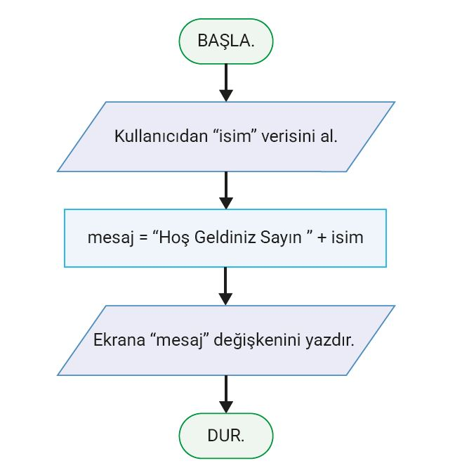
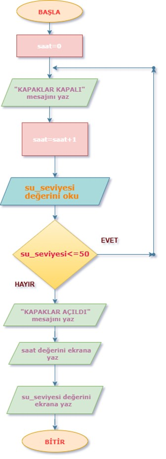

# kod_asistanim
Proje Yazarı: Adınızı ve soyadınızı yazınız.

# Projenin Adı: Kod-Asistan v0.1
##  Projenin  Amacı:  Kullanıcılara  günlük  işlerinde  (hesaplama,  selamlama  vb.)  yardımcı 
olacak bir dijital asistan tasarlamak
##  Projenin  Hedefleri:  Bu  asistanın  ilerleyen  zamanlarda  hangi  özellikleri  kazanacağını
(örneğin v1.0 Akıllı Menü, v2.0 Veri Saklama) maddeler hâlinde yazınız.
## ALGORİTMA
1.	başla
2.	saat=0 
3.	ekrana kapaklar kapalı yaz
4.	saat=saat+1
5.	su_seviyesi değerini sensörden oku 
6.	Eğer su_seviyesi <= 50 ise 3.adıma git
7.	değilse ekrana “kapaklar açıldı”, saat ve su_seviyesini yazdır
8.	bitir

## AKIŞ ŞEMASI

